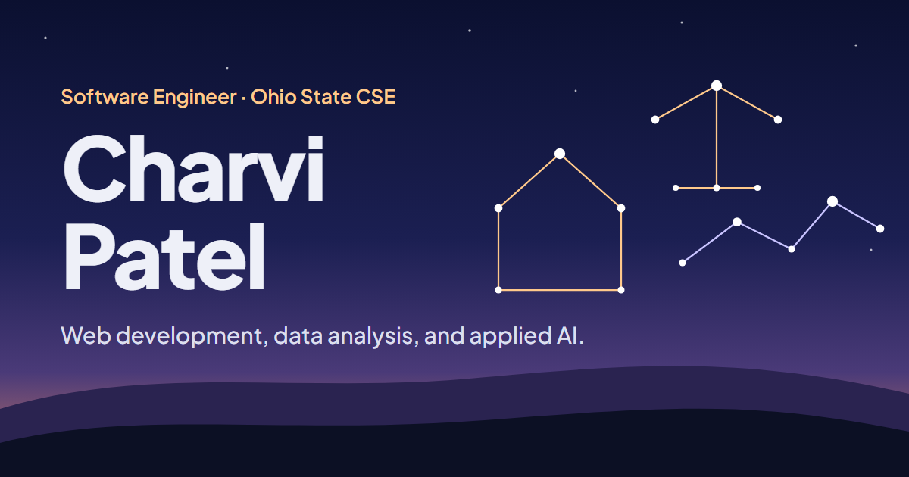

# Charvi Patel — Portfolio



Personal portfolio for Charvi Patel, a software engineer and Ohio State CSE graduate working in web development, SQL data analysis, and applied AI. It is a single static page: one `index.html`, no build step, no dependencies.

## Features

- **Interactive project map:** each project is a constellation. Hovering connects its stars, and clicking jumps to that project's card.
- **Responsive:** the map switches to a stacked layout on phones, and labels scale to stay readable at every width.
- **Accessible:** keyboard navigation (Tab, then Enter or Space on the map), visible focus states, and `prefers-reduced-motion` support.
- **Lightweight:** plain HTML, CSS, and a little vanilla JavaScript. The only external request is the Plus Jakarta Sans font from Google Fonts.

## Run it locally

No install needed. Either open `index.html` in a browser, or serve the folder:

```bash
python -m http.server 8000
```

Then visit <http://localhost:8000>.

## Contact

- Email: [charvipatel02@gmail.com]
- GitHub: [@charvip](https://github.com/charvip)
- LinkedIn: [charvipatel02](https://www.linkedin.com/in/charvipatel02)
